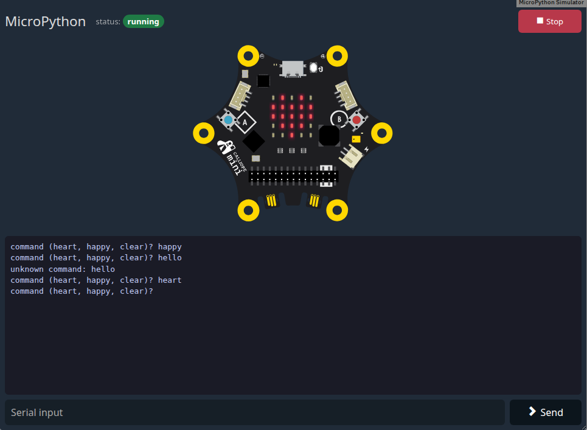

# Edrys MicroPython Simulator Module

A MicroPython simulator for [edrys-Lite](https://github.com/edrys-labs/edrys-Lite). It runs Python programs on a
simulated **Calliope mini 3** or **BBC micro:bit v2** in the browser and shows the serial output (`print`,
tracebacks) in a terminal, with no hardware required. The simulated board has working LEDs, buttons, pins and sound.



Import the module via:

```
https://edrys-labs.github.io/module-micropython-simulator/index.html
```

It needs an editor module that sends Python code, such as
[module-monaco-editor](https://github.com/edrys-labs/module-monaco-editor) (with `runCommand: execute`).

**Simulators:** the module comes with copies of the simulators the Calliope and micro:bit Python editors use (in
[simulators/](simulators), see [Updating the simulators](#updating-the-simulators)). Everything is served with the
module, so it doesn't depend on other sites. The programs run in the browser: no code is sent to a server.

---

## Configuration

| Property      | Type    | Description                                                        | Default             |
|---------------|---------|--------------------------------------------------------------------|---------------------|
| `board`       | String  | `calliope-mini-3` or `microbit-v2`                                 | `"calliope-mini-3"` |
| `execute`     | String  | Edrys message subject the module runs code from                    | `"execute"`         |
| `sensors`     | String  | Sensor controls below the board, see [Sensors](#sensors)           | `""` (none)         |
| `synchronize` | Boolean | Run code sent by any peer in the room on every peer in that room   | `false`             |

Programs import the board's module: `from calliopemini import *` on the Calliope mini 3,
`from microbit import *` on the micro:bit. The Calliope mini 1 and 2 have no MicroPython simulator.

By default, each peer runs only the code it sent itself. With `synchronize: true`, a program from anyone in the
room starts on every peer in the room (each peer runs its own simulation, so button presses stay local). The last
program is kept in the room state under `micropython:<execute>` (e.g. `micropython:execute`), so peers who join
later or reload get it too. Stop is shared the same way: it stops every peer and removes the stored program.

**YAML example:**

```yaml
board: calliope-mini-3
execute: execute
sensors: temperature:0:40, lightLevel, gesture
synchronize: false
```

**JSON example:**

```json
{
  "board": "microbit-v2",
  "execute": "execute",
  "synchronize": false
}
```

---

## Using the Module

- **Header:** the status badge shows `idle`, `running`, `stopped` or `error`. **Stop** (red while a program runs)
  stops the board.
- **Board:** a program starts as soon as it arrives. Click the board's buttons and pins as on the real one. After
  Stop, ▶ on the board runs the last program again from the beginning (before the first program, ▶ starts the
  `>>>` prompt).
- **Sound:** browsers allow sound only after a click, so the board is silent until the first click or key press on
  it. The program runs anyway, and sounds before that click are not heard.
- **Terminal:** the serial output. A new program clears it. Only the newest 100,000 characters are kept.
- **Input:** type a line and press Enter or **Send**. It is sent with a carriage return, as Enter on the board's
  serial, so `input()` reads it. MicroPython echoes what it reads.
- **`>>>` prompt:** when the program has ended, the board starts MicroPython's prompt, and lines sent from the
  input run there (`6*7` → `42`). After an error, the board first scrolls the error over its display.

### Sensors

The board's buttons and pins are clicked on the board itself. For its other sensors, `sensors` adds controls
below the board: a comma-separated list of sensors, each with an optional `:min:max` range for its slider.
`all` adds every sensor; without `sensors` (or with `none`) there are no controls.

| Sensor           | Control  | Range                          | Default | Read in Python                                  |
|------------------|----------|--------------------------------|---------|-------------------------------------------------|
| `temperature`    | slider   | −5 to 50 °C                    | 21      | `temperature()`                                 |
| `lightLevel`     | slider   | 0 to 255                       | 127     | `display.read_light_level()`                    |
| `soundLevel`     | slider   | 0 to 255                       | 0       | `microphone.sound_level()`                      |
| `accelerometerX`, `accelerometerY`, `accelerometerZ` | slider | −2000 to 2000 mg | 0 | `accelerometer.get_x()`, …               |
| `gesture`        | choice   | `none`, `up`, `down`, `left`, `right`, `face up`, `face down`, `freefall`, `3g`, `6g`, `8g`, `shake` | `none` | `accelerometer.was_gesture("shake")`, … |
| `compassHeading` | slider   | 0 to 360°                      | 0       | `compass.heading()`                             |
| `compassX`, `compassY`, `compassZ` | slider | −2,000,000 to 2,000,000 nT | 0  | `compass.get_x()`, …                            |

Names are case-insensitive. A range must lie within the sensor's range (e.g. `temperature:0:40`). Entries that
are unknown or have an invalid range are skipped with a warning in the browser console.

```yaml
sensors: temperature:0:40, lightLevel, gesture   # three controls
sensors: all                                     # every sensor
```

The board keeps the values when a new program starts. When a program changes a range (e.g.
`accelerometer.set_range(8)` makes it ±8000 mg), the slider follows. The values are local: each peer sets its
own, also with `synchronize`, like pressing a button on the board.

### Example: sensors

With this configuration, the module shows a temperature slider (0 to 40 °C) and a light level slider below the
board:

```yaml
board: calliope-mini-3
sensors: temperature:0:40, lightLevel
```

The program prints both values every second and shows a face: sad above 30 °C, asleep in the dark (light level
below 50), happy otherwise. Move the sliders to see it change (on the micro:bit, import `microbit` instead of
`calliopemini`):

```python
from calliopemini import *

while True:
    temp = temperature()
    light = display.read_light_level()
    print("temperature:", temp, "light:", light)
    if temp > 30:
        display.show(Image.SAD)
    elif light < 50:
        display.show(Image.ASLEEP)
    else:
        display.show(Image.HAPPY)
    sleep(1000)
```

### Example: serial input

The program asks for a command, reads the line sent from the input field with `input()`, and shows an image on
the LEDs (on the micro:bit, import `microbit` instead of `calliopemini`):

```python
from calliopemini import *

while True:
    command = input("command (heart, happy, clear)? ")
    if command == "heart":
        display.show(Image.HEART)
    elif command == "happy":
        display.show(Image.HAPPY)
    elif command == "clear":
        display.clear()
    else:
        print("unknown command:", command)
```

Sending `heart`, then `hello` from the input field shows a heart on the board, and the terminal shows:

```
command (heart, happy, clear)? heart
command (heart, happy, clear)? hello
unknown command: hello
command (heart, happy, clear)? 
```

### Code format

The module accepts plain Python, or a project as [module-editor](https://github.com/edrys-labs/module-editor)'s
multi-file mode sends it:

```json
{ "file": { "main.py": "import util\nprint(util.twice(21))", "util.py": "def twice(x):\n    return 2 * x" } }
```

All files go onto the board's filesystem and `main.py` runs. Without a `main.py`, the first `.py` file becomes
`main.py`.

---

## Updating the simulators

[simulators/](simulators) holds copies of the hosted simulators, one folder per board:

| Folder                         | Copied from                                           | Source |
|--------------------------------|-------------------------------------------------------|--------|
| `simulators/calliope-mini-3/`  | `https://simulator.python.calliope.cc/`               | [calliope-edu/micropython-simulator](https://github.com/calliope-edu/micropython-simulator) |
| `simulators/microbit-v2/`      | `https://python-simulator.usermbit.org/v/0.1/`        | [microbit-foundation/micropython-microbit-v2-simulator](https://github.com/microbit-foundation/micropython-microbit-v2-simulator) |

Each folder holds `simulator.html` and `build/` (the simulator and MicroPython compiled to WebAssembly), the
upstream `LICENSE`, and `UPSTREAM` with the date of the copy and the checksums of the files as downloaded.

`build/simulator.js` is patched: the original creates its audio only when the play button on the board is
clicked, and refuses to start a program before that. The patched one creates the audio when a program starts and
switches it on with the first click or key press on the board.

[scripts/update-simulators.sh](scripts/update-simulators.sh) makes the copies (it needs `bash`, `curl`,
`sha256sum` and `python3`):

```bash
scripts/update-simulators.sh --check   # only report whether upstream changed (exit code 1 if so)
scripts/update-simulators.sh           # download, patch and replace the copies that changed
```

After an update, run the tests and commit `simulators/`; `git checkout simulators/` brings the old copies back.
If upstream changed the code the patch targets, the script stops with an error and changes nothing; then the patch
in the script needs updating.

The module only ever loads its own copies, never the hosted simulators.

---

## Tests

End-to-end tests run the module in a real edrys-Lite, see
[edrys-module-tests](https://github.com/edrys-labs/edrys-module-tests) (`modules/module-micropython-simulator`).
They check that nothing is loaded from the hosted simulators.

---

## Credits

- [micropython-microbit-v2-simulator](https://github.com/microbit-foundation/micropython-microbit-v2-simulator)
  by the Micro:bit Educational Foundation (MIT, see [simulators/microbit-v2/LICENSE](simulators/microbit-v2/LICENSE))
- [micropython-simulator](https://github.com/calliope-edu/micropython-simulator) by Calliope gGmbH, a fork of the
  micro:bit simulator (MIT, see [simulators/calliope-mini-3/LICENSE](simulators/calliope-mini-3/LICENSE))
- [MicroPython](https://micropython.org) (MIT)

---

## License

[MIT](LICENSE) © edrys-labs. The copies in [simulators/](simulators) keep their own MIT licenses.
